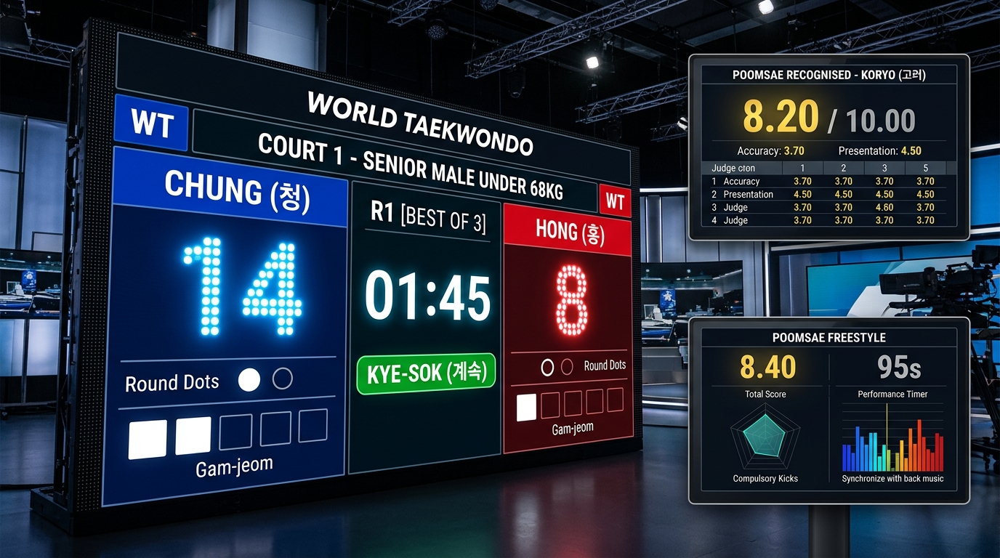
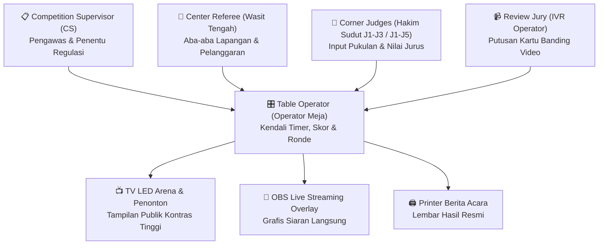
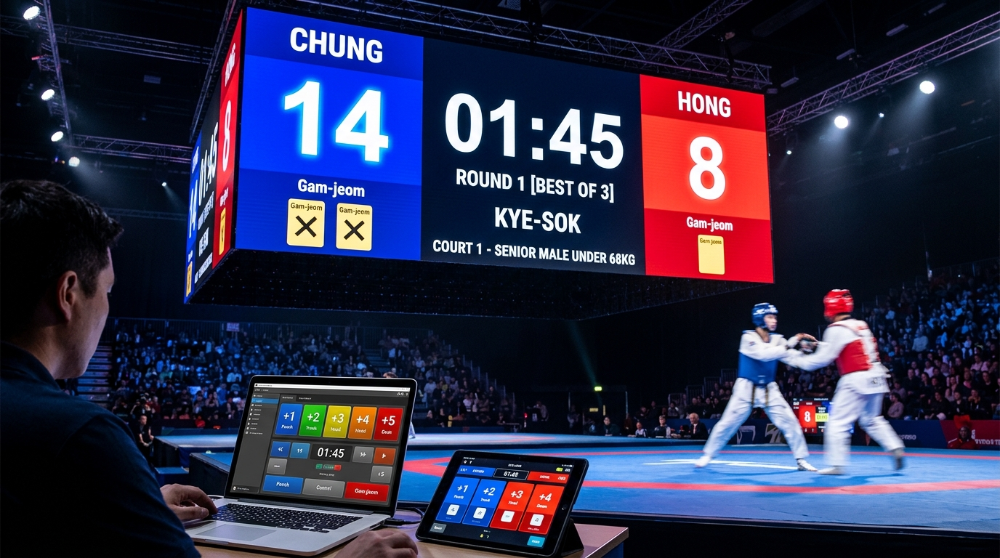
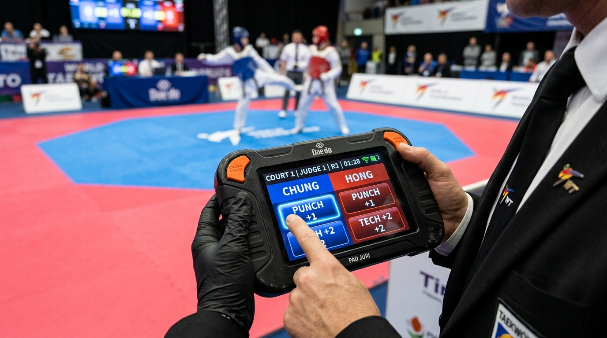
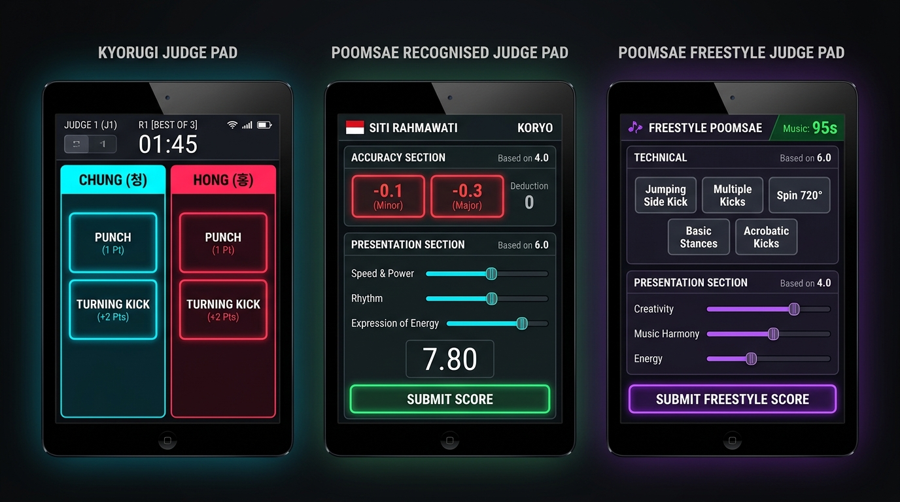

`# BUKU PANDUAN LENGKAP SISTEM ELECTRONIC SCORING BOARD TAEKWONDO
## Standar Resmi World Taekwondo (WT) — Mengacu Sistem DAEDO TK-Strike & KPNP PSS



---

## DAFTAR ISI
1. [BAB 1: Pengantar Sistem Scoring Board Taekwondo Modern](#bab-1-pengantar-sistem-scoring-board-taekwondo-modern)
2. [BAB 2: Struktur Organisasi & Peran Pengguna (Roles & Permissions)](#bab-2-struktur-organisasi--peran-pengguna-roles--permissions)
3. [BAB 3: Spesifikasi & Algoritma Kategori Kyorugi (Sparring)](#bab-3-spesifikasi--algoritma-kategori-kyorugi-sparring)
4. [BAB 4: Spesifikasi & Algoritma Kategori Poomsae Recognised (Jurus Baku)](#bab-4-spesifikasi--algoritma-kategori-poomsae-recognised-jurus-baku)
5. [BAB 5: Spesifikasi & Algoritma Kategori Poomsae Freestyle (Jurus Bebas)](#bab-5-spesifikasi--algoritma-kategori-poomsae-freestyle-jurus-bebas)
6. [BAB 6: Desain Perangkat Pad Juri (KPNP & Daedo JSD Standard)](#bab-6-desain-perangkat-pad-juri-kpnp--daedo-jsd-standard)
7. [BAB 7: Arsitektur Perangkat Lunak, Data State & Sinkronisasi Layar](#bab-7-arsitektur-perangkat-lunak-data-state--sinkronisasi-layar)
8. [BAB 8: Standar Operasional Prosedur (SOP) & Berita Acara Pertandingan](#bab-8-standar-operasional-prosedur-sop--berita-acara-pertandingan)

---

## BAB 1: Pengantar Sistem Scoring Board Taekwondo Modern

### 1.1 Evolusi Penilaian Taekwondo: Dari Manual ke PSS Elektrik
Dalam sejarah olahraga bela diri Taekwondo, sistem penilaian telah bertransformasi dari sistem manual kertas, sistem tombol klik manual (*mechanical clicker*), hingga era modern berbasis **PSS (*Protector and Scoring System*)**.

Pada era PSS saat ini, turnamen resmi di bawah naungan **World Taekwondo (WT)** menggunakan pelindung dada elektrik (*e-hogu*) dan pelindung kepala elektrik (*e-headgear*) dengan sensor nirkabel berteknologi RFID dan sensor tekanan benturan (*impact & proximity sensor*). Dua merek sistem PSS resmi yang diakui dunia dan menjadi standar Olimpiade adalah **DAEDO (TK-Strike Gen2)** dan **KPNP**.

### 1.2 Tujuan & Fungsi Electronic Scoring Board
Aplikasi **Electronic Scoring Board (Papan Skor Digital)** berfungsi sebagai pusat pengendali dan pusat visual pertandingan:
1. **Pusat Komando Waktu & Pertandingan:** Mengendalikan durasi ronde, waktu istirahat, jeda wasit (*Kal-yeo*), dan waktu darurat medis (*Kye-shi*).
2. **Kalkulator Skor Otomatis:** Menghitung akumulasi poin teknik, penalti pelanggaran (*Gam-jeom*), aturan selisih skor (*Point Gap*), serta pemotongan nilai ekstrem (*Truncated Mean*) pada jurus Poomsae.
3. **Penyaji Informasi Real-Time:** Menampilkan data pertandingan dengan rasio kontras tinggi ke layar raksasa (*Big Screen TV / LED Display*) untuk atlet, pelatih, wasit, penonton arena, dan siaran langsung televisi/streaming (*OBS Studio*).

---

## BAB 2: Struktur Organisasi & Peran Pengguna (Roles & Permissions)

Dalam sebuah ring pertandingan (*Court / Matras Oktagon*), ekosistem scoring board mengintegrasikan 5 peran (*roles*) pengguna dengan tingkat otorisasi yang terdefinisi secara ketat:



### 2.1 Competition Supervisor (CS) / Ketua Pertandingan
* **Tanggung Jawab:** Bertanggung jawab penuh atas kelancaran seluruh ring di arena kejuaraan.
* **Hak Akses:**
  - Mengonfigurasi master turnamen (nama kejuaraan, nama ring/court, jumlah juri, aturan durasi).
  - Melakukan *override* (koreksi manual) terhadap status pertandingan jika terjadi banding resmi delegasi teknik.
  - Menandatangani lembar Berita Acara Pertandingan resmi.

### 2.2 Table Operator (Operator Meja Pertandingan)
* **Tanggung Jawab:** Bertugas di meja utama di sisi matras menjalankan perangkat lunak scoring board.
* **Hak Akses:**
  - Memulai (*Kye-sok*), menjeda (*Kal-yeo*), dan mereset timer ronde.
  - Memasukkan poin koreksi dan mencatat penalti *Gam-jeom* atas instruksi wasit tengah.
  - Mengaktifkan waktu cedera medis (*Kye-shi 1:00*).
  - Memuat data atlet dari jadwal partai (*match queue*) dan mencetak hasil akhir partai.

### 2.3 Center Referee (Wasit Tengah)
* **Tanggung Jawab:** Memimpin pertarungan di dalam matras oktagon.
* **Wewenang Terhadap Sistem:**
  - Memberi aba-aba resmi dalam bahasa Korea (*Kye-sok*, *Kal-yeo*, *Kye-shi*, *Keuman*).
  - Mengarahkan operator meja untuk menambahkan atau membatalkan penalti *Gam-jeom*.
  - Menyatakan pemenang ronde dan pertandingan (*Chung Seung / Hong Seung*).

### 2.4 Corner Judges (Hakim Sudut J1 – J3 pada Kyorugi / J1 – J5 pada Poomsae)
* **Tanggung Jawab:** Menilai teknik manual menggunakan perangkat sentuh nirkabel (*Wireless Judge Scoring Device / JSD*).
* **Hak Akses:**
  - **Kyorugi:** Menekan tombol pukulan sah (*Punch 1 Pt*) dan validasi tendangan berputar (*Tech +2 Pts*).
  - **Poomsae:** Memotong nilai akurasi (`-0.1` dan `-0.3`) dan menentukan nilai presentasi (0.00 – 6.00).

### 2.5 Review Jury / IVR Operator (Instant Video Replay)
* **Tanggung Jawab:** Meninjau rekaman video multi-sudut bila pelatih mengajukan kartu banding video (*Coach Challenge*).
* **Hak Akses:** Menentukan putusan *Accepted* (Diterima) atau *Rejected* (Ditolak) pada sistem scoring board.

---

## BAB 3: Spesifikasi & Algoritma Kategori Kyorugi (Sparring)



Kategori Kyorugi mengadopsi regulasi resmi World Taekwondo (WT) terkini yaitu **Format "Best of 3 Rounds" (3전 2선승제)**.

### 3.1 Bobot Nilai Poin Teknik
Poin diberikan berdasarkan sasaran yang sah dan kompleksitas teknik yang dieksekusi:

| Teknik Serangan | Area Sasaran | Poin Sah | Metode Deteksi Sistem |
| :--- | :--- | :---: | :--- |
| **Pukulan Lurus (Punch / 주먹)** | Pelindung Badan (*Trunk*) | **1 Poin** | Persetujuan minimal **2 dari 3 hakim sudut** dalam 1.0 detik. |
| **Tendangan Badan (Trunk Kick / 몸통)** | Pelindung Badan (*Trunk*) | **2 Poin** | Sensor tekanan PSS (*e-hogu*) melampaui batas ambang benturan (*impact threshold*). |
| **Tendangan Putar Badan (Turning Trunk / 몸통 회전)** | Pelindung Badan (*Trunk*) | **4 Poin** | Sensor PSS badan (2 poin) + Validasi teknik putar juri (+2 poin teknis). |
| **Tendangan Kepala (Head Kick / 머리)** | Pelindung Kepala (*Headgear*) | **3 Poin** | Sensor PSS helm (*e-headgear*) mendeteksi benturan. |
| **Tendangan Putar Kepala (Turning Head / 머리 회전)** | Pelindung Kepala (*Headgear*) | **5 Poin** | Sensor PSS helm (3 poin) + Validasi teknik putar juri (+2 poin teknis). |
| **Gam-Jeom (Pelanggaran / 감점)** | Seluruh Pelanggaran | **+1 Poin** | Diberikan langsung sebagai tambahan 1 poin untuk lawan. |

### 3.2 Sistem Best of 3 Rounds
1. Pertandingan berlangsung maksimal 3 ronde.
2. Atlet yang terlebih dahulu memenangkan **2 ronde** (skor ronde `2 - 0` atau `2 - 1`) dinyatakan sebagai pemenang pertandingan.
3. **Aturan Reset Skor:** Pada akhir setiap ronde, pemenang ronde ditentukan, lalu **skor poin dan penalti Gam-jeom di-reset menjadi 0 - 0** pada awal ronde berikutnya.
4. **Indikator Ronde:** Ditandai dengan 2 lampu bulat (*round won dots* ● ○) di samping nama masing-masing atlet.

### 3.3 Kriteria Penentuan Pemenang Ronde Seri (Tie-Break Logic)
Jika sebuah ronde berakhir dengan skor angka sama (misal `6 - 6`), pemenang ronde ditentukan secara otomatis berdasarkan urutan hierarki prioritas WT:
1. Poin terbanyak yang diperoleh dari **teknik tendangan memutar** (*turning kicks*).
2. Jika masih sama: Poin yang diperoleh dari teknik bernilai lebih tinggi (Kepala > Badan > Pukulan).
3. Jika masih sama: Jumlah benturan sah terdaftar pada sensor PSS (*total registered hit count*).
4. Jika masih sama: Keputusan keunggulan juri (*Superiority / Referee & Judges Decision*).

### 3.4 Aturan Penghentian Ronde & Pertandingan Sebelum Waktu Habis
* **Point Gap (점수차 승리):** Jika salah satu atlet unggul dengan selisih **12 poin** dalam ronde tersebut, ronde dihentikan seketika dan ronde dimenangkan oleh atlet yang unggul.
* **Batas Maksimal Gam-Jeom (5 Gam-Jeom RSC):** Jika seorang atlet menerima **5 Gam-Jeom dalam 1 ronde**, atlet tersebut otomatis dinyatakan kalah pada ronde tersebut oleh wasit (*Referee Stops Contest*).
* **KO / RSC:** Kemenangan mutlak karena lawan tidak mampu melanjutkan pertandingan.

### 3.5 Instant Video Replay (IVR) & Kesiapan Medis (Kye-shi)
* **Kuota Kartu Banding:** Setiap pelatih memiliki 1 kuota kartu banding video per pertandingan. Jika banding diterima (*Accepted*), kartu tetap dipegang pelatih. Jika ditolak (*Rejected*), hak banding gugur untuk sisa pertandingan.
* **Kye-shi (계시 — 1:00 Medical Timeout):** Jika atlet mengalami cedera akibat benturan sah, wasit memberikan waktu perawatan medis maksimal **60 detik**. Jika dalam 60 detik atlet tidak siap tanding, lawan dinyatakan menang (*Win by RSC*).

---

## BAB 4: Spesifikasi & Algoritma Kategori Poomsae Recognised (Jurus Baku)

Penilaian Poomsae Baku mengevaluasi kesempurnaan teknik standar Taekwondo (Taegeuk 1-8 Jang, Koryo, Keumgang, Taebaek, Pyongwon, Sipjin, dll.) dengan skala nilai maksimal **10.00**.

### 4.1 Komponen Nilai Akurasi (Accuracy — Maksimal 4.00)
Menggunakan sistem pemotongan nilai (*deduction system*) dari nilai dasar 4.00:

#### A. Pemotongan Minor (-0.1 Poin per Kesalahan):
* Sudut kuda-kuda (*seogi*) tidak tepat (kurang lebar, sudut kaki melenceng).
* Titik akhir tangkisan atau pukulan tidak tepat pada garis sumbu sasaran tubuh.
* Jeda transisi antar gerakan sedikit goyah atau kehilangan keseimbangan ringan.
* Kecepatan gerak pembuka atau penutup (*Charyeot / Joonbi*) tidak sesuai tempo 5 detik.

#### B. Pemotongan Mayor (-0.3 Poin per Kesalahan):
* Melakukan teknik yang salah (misal: harusnya tangkisan pisau tangan *Sonnal Makki*, malah tangkisan kepalan *Momtong Makki*).
* Melupakan gerakan atau terhenti di tengah jalan lebih dari 3 detik.
* Kehilangan keseimbangan total (terjatuh, langkah tambahan tidak terkontrol).
* Suara hentakan kaki (*stomp*) yang berlebihan pada gerakan yang tidak mensyaratkan hentakan.
* Tidak berteriak (*Kihap*) pada gerakan yang diwajibkan, atau berteriak di tempat yang salah.

### 4.2 Komponen Nilai Presentasi (Presentation — Maksimal 6.00)
Dievaluasi berdasarkan 3 parameter resmi WT (masing-masing 0.00 – 2.00):
1. **Speed & Power (0.00 – 2.00):** Daya ledak saat teknik mencapai titik akhir, serta kecepatan pelepasan gerakan.
2. **Rhythm & Tempo (0.00 – 2.00):** Kontras yang harmonis antara gerakan lambat bertekanan tenaga dalam dan gerakan cepat eksplosif.
3. **Expression of Energy / Kihap (0.00 – 2.00):** Penguasaan diri, fokus pandangan mata, dan pancaran semangat juang.

### 4.3 Algoritma Perhitungan Truncated Mean (절사평균)
Untuk menjaga independensi penilaian dari keberpihakan juri, diterapkan metode **Truncated Mean** pada panel 5 atau 7 juri:

$$\text{Nilai Akurasi Akhir} = \frac{\sum \text{Akurasi Sisa Juri}}{N - 2}$$

$$\text{Nilai Presentasi Akhir} = \frac{\sum \text{Presentasi Sisa Juri}}{N - 2}$$

$$\text{Total Skor Akhir} = \text{Akurasi Akhir} + \text{Presentasi Akhir} - \text{Penalti Panitia}$$

*Contoh Perhitungan Panel 5 Juri:*
* Akurasi J1–J5: `[3.7, 3.8, 3.6, 3.9, 3.5]` $\rightarrow$ Nilai tertinggi `3.9 (J4)` dan terendah `3.5 (J5)` **dibuang**. Sisa: `3.7, 3.8, 3.6` $\rightarrow$ Rata-rata = **3.70**.
* Presentasi J1–J5: `[4.5, 4.6, 4.3, 4.7, 4.4]` $\rightarrow$ Nilai tertinggi `4.7 (J4)` dan terendah `4.3 (J3)` **dibuang**. Sisa: `4.5, 4.6, 4.4` $\rightarrow$ Rata-rata = **4.50**.
* **Total Skor = 3.70 + 4.50 = 8.20**.

---

## BAB 5: Spesifikasi & Algoritma Kategori Poomsae Freestyle (Jurus Bebas)

Kategori Freestyle memadukan seni bela diri Taekwondo dengan kreativitas koreografi, akrobatik, dan iringan musik berdurasi **90 hingga 100 detik**. Nilai total maksimal adalah **10.00**.

### 5.1 Technical Skills (Keahlian Teknik — Maksimal 6.00)
Mencakup **5 Elemen Teknik Wajib (Compulsory Techniques)** bernilai masing-masing 0.0 – 1.0 poin + 1.0 poin untuk Teknik Dasar:
1. **Jumping Side Kick (Tinggi Lompatan Samping):** Menilai ketinggian lompatan kaki saat menendang lurus ke samping.
2. **Multiple Kicks in a Jump (Jumlah Sasaran Udara):** Menilai banyaknya tendangan beruntun di udara dalam 1 kali lompatan (minimal 3 sampai 5 target tendangan sebelum mendarat).
3. **Spinning Kick (Derajat Putaran):** Tendangan memutar tingkat kesulitan tinggi (putaran 540°, 720°, atau lebih).
4. **Taekwondo Basic Stances & Movements:** Rangkaian kuda-kuda baku dan tangkisan berturut-turut (*Yeon-mu line*).
5. **Acrobatic Kicks Sequence:** Kombinasi tendangan akrobatik salto (*backflip kick, webster, b-twist kick*).
6. **Basic TKD Stances & Balance:** Keseimbangan tubuh dan kerapian saat mendarat.

### 5.2 Presentation (Penyajian & Harmoni Musik — Maksimal 4.00)
1. **Creativity (0.0 – 1.0):** Keunikan dan inovasi penyusunan pola koreografi gerak.
2. **Harmony with Music (0.0 – 1.0):** Keselarasan ketukan gerak dengan irama instrumen musik pengiring.
3. **Expression of Energy (0.0 – 1.0):** Dinamika kekuatan dan stamina selama 90-100 detik.
4. **Rhythm & Synchronization (0.0 – 1.0):** Sinkronisasi keserempakan gerakan (khusus kategori Pair atau Team).

### 5.3 Aturan Penalti Durasi & Lapangan
* **Jendela Waktu Pertunjukan:** 90 – 100 detik.
  * Kurang dari 90 detik atau lebih dari 100 detik: **-0.3 poin per interval 10 detik**.
* **Keluar Garis Batas Lapangan (*Boundary Line*):** -0.3 poin per pelanggaran.

---

## BAB 6: Desain Perangkat Pad Juri (KPNP & Daedo JSD Standard)



### 6.1 Karakteristik Fisik & Ergonomi Hardware
Perangkat Pad Juri (*Wireless Judge Scoring Device*) mengadopsi model konsol genggam (*handheld*) dengan spesifikasi:
* **Casing Industri Rugged:** Tepi berkontur karet tebal tahan benturan dengan pegangan bertekstur anti-selip (*ergonomic grip*).
* **Telemetri Layar Atas:** Menampilkan indikator baterai (`🔋 98%`), status frekuensi nirkabel (`📶 2.4GHz RF`), nomor ring (`COURT 1`), nomor juri (`JUDGE 1`), ronde (`R1`), dan timer pertandingan digital.
* **Tata Letak Jempol Ganda:** Membagi layar menjadi sisi kiri Biru (*Chung*) dan sisi kanan Merah (*Hong*) yang dapat dioperasikan secara responsif oleh kedua jempol tangan tanpa perlu melihat layar (*blind touch capability*).

### 6.2 Perbandingan Layar Fullscreen 3 Kategori Pertandingan



1. **Pad Juri Kyorugi:**
   - Tombol sentuh ekstra besar **🥊 PUKULAN (PUNCH — 1 Pt)**.
   - Tombol sekunder **⚡ TEKNIK PUTAR (TECH — +2 Pts)**.
   - Tombol cadangan **🎯 KEPALA MANUAL (HEAD — +3 Pts)**.
   - Dilengkapi animasi cincin putih dan status *"READY 1.0s"* setiap kali tombol ditekan.
2. **Terminal Juri Poomsae Recognised:**
   - Gauge nilai akurasi berjalan (mulai dari 4.00).
   - Tombol deduksi cepat: `[-0.1 Minor]`, `[-0.3 Major]`, `[+0.1 Undo/Cancel]`, dan `[Reset 4.0]`.
   - Slider sentuh 3 parameter presentasi WT (*Speed & Power*, *Rhythm*, *Energy*).
   - Tombol transmisi hijau: *"✓ KIRIM NILAI KE SERVER PSS"*.
3. **Terminal Juri Poomsae Freestyle:**
   - 6 Kotak input nilai teknik wajib (0.0 – 1.0).
   - 2 Kotak input koreografi dan musik (0.0 – 1.0).
   - Monitor waktu musik pertunjukan (90s – 100s).
   - Tombol transmisi ungu: *"⚡ KIRIM NILAI FREESTYLE"*.

---

## BAB 7: Arsitektur Perangkat Lunak, Data State & Sinkronisasi Layar

### 7.1 Skema Data State Tunggal (Single Source of Truth)
Aplikasi dibangun menggunakan pola arsitektur state terpusat (*Centralized State Management*) dengan format data JSON terstruktur:

```json
{
  "court": "COURT 1",
  "category": "kyorugi",
  "division": "SENIOR PUTRA UNDER 68 KG",
  "matchNumber": "PARTAI #04",
  "viewMode": "tv",
  "kyorugi": {
    "round": 1,
    "maxRounds": 3,
    "timerSeconds": 120,
    "timerRunning": false,
    "chung": { "name": "AHMAD RIZKY", "team": "JAWA BARAT", "score": 14, "gamjeom": 2, "roundsWon": 1 },
    "hong": { "name": "BUDI SANTOSO", "team": "DKI JAKARTA", "score": 8, "gamjeom": 1, "roundsWon": 0 }
  },
  "poomsaeRec": {
    "athleteName": "SITI RAHMAWATI",
    "poomsaeName": "KORYO (고려)",
    "result": { "accuracyFinal": 3.70, "presentationFinal": 4.50, "totalScore": 8.20 }
  }
}
```

### 7.2 Sinkronisasi Dual-Screen Tanpa Server (0ms Latensi)
Untuk menghubungkan Laptop Operator di meja pertandingan dengan TV LED penonton di lapangan tanpa ketergantungan koneksi internet:
* **Teknologi BroadcastChannel API:** Setiap event penambahan poin, jeda timer, atau penalti di tab operator dipancarkan melalui channel `'tkd_scoreboard_event_channel'`. Layar TV pada monitor kedua menerima payload dan langsung merender pembaruan secara instan (< 5 milidetik).
* **LocalStorage Fallback & Auto-Restore:** Seluruh state pertandingan dicatat ke penyimpanan lokal browser. Jika browser tidak sengaja ter-refresh atau tertutup, data skor dan timer tidak akan hilang.

### 7.3 Generator Suara Klakson Turnamen (Web Audio API 100% Offline)
Sistem audio tidak memerlukan file eksternal MP3 yang rentan gagal dimuat. Suara disintesis secara matematis menggunakan Web Audio API:
* **Klakson Buzzer Resmi (Dual-Sawtooth Synthesizer):** Menggabungkan frekuensi 285 Hz dan 427.5 Hz dengan modulasi harmonik selama 1.35 detik untuk mereplikasi klakson buzzer resmi Daedo/KPNP.
* **Aba-aba Kal-yeo & Kye-sok:** Suara beep dua-nada frekuensi 659.25 Hz dan 523.25 Hz.
* **Peringatan Gam-Jeom:** Nada peringatan segitiga frekuensi 330 Hz.

### 7.4 Mode Siaran Langsung (OBS Studio / vMix Overlay)
Aplikasi menyediakan mode khusus `index.html?mode=obs` dengan latar belakang transparan (*alpha channel*). Operator live stream cukup menambahkan *Browser Source* di OBS Studio untuk menampilkan *Lower-Third Scoreboard* berstandar siaran Grand Prix World Taekwondo.

---

## BAB 8: Standar Operasional Prosedur (SOP) & Berita Acara Pertandingan

### 8.1 Checklist Pra-Pertandingan (Pre-Match Checklist)
1. Sambungkan kabel HDMI dari laptop operator ke TV LED arena.
2. Atur display Windows ke mode **Extend** (`Win + P`).
3. Buka tab operator di layar laptop (`index.html?mode=operator`) dan tab display di layar TV (`index.html?mode=tv`). Tekan **F11** pada layar TV.
4. Klik tombol **"⚙️ Setelan"** untuk memastikan nama kejuaraan, nama ring, dan durasi ronde sudah sesuai kelas tanding.
5. Tekan tombol **"🔊 Buzzer"** untuk menguji sistem audio arena.

### 8.2 Prosedur Selama Pertandingan (During-Match SOP)
* **Kye-sok:** Tekan **[Spasi]** untuk memulai hitung mundur timer saat wasit memberi aba-aba tanding.
* **Kal-yeo:** Tekan **[Spasi]** saat wasit menghentikan sementara pertandingan.
* **Gam-jeom:** Klik tombol `+1 Gam-jeom` pada sudut atlet yang melakukan pelanggaran (poin lawan akan otomatis bertambah 1).
* **Point Gap:** Bila selisih mencapai 12 poin, sistem memunculkan peringatan kuning; wasit menghentikan ronde.
* **Akhir Ronde:** Klakson buzzer berbunyi otomatis saat waktu mencapai `00:00`. Evaluasi pemenang ronde dan klik `Ronde Berikutnya ⏩`.

### 8.3 Format Berita Acara Pertandingan Resmi (Scoresheet Printout)
Setelah pertandingan usai, operator mengklik tombol **"🖨️ Cetak"** untuk mencetak Berita Acara Pertandingan resmi:

```text
================================================================================
                   KEJUARAAN NASIONAL TAEKWONDO CHAMPIONSHIP
             BERITA ACARA & LEMBAR HASIL RESMI PERTANDINGAN (WT)
================================================================================
Ring / Court  : COURT 1                     Nomor Partai : PARTAI #04
Divisi / Kelas: SENIOR PUTRA UNDER 68 KG    Waktu Cetak  : 10/11/2026, 11:45:00
--------------------------------------------------------------------------------
RONDE    CHUNG (JAWA BARAT)        HONG (DKI JAKARTA)        PEMENANG RONDE
--------------------------------------------------------------------------------
Ronde 1  14 Poin (Gamjeom: 2)      8 Poin (Gamjeom: 1)       CHUNG (BIRU)
Ronde 2  10 Poin (Gamjeom: 1)      6 Poin (Gamjeom: 0)       CHUNG (BIRU)
Ronde 3  -                         -                         -
--------------------------------------------------------------------------------
PEMENANG PARTAI RESMI : AHMAD RIZKY (CHUNG / JAWA BARAT)
KEPUTUSAN KEMENANGAN  : Menang Best of 3 Rounds (Skor Ronde: 2 - 0)
================================================================================

Tanda Tangan Pengesahan:

  Wasit Tengah (Center Referee)       Operator Meja            Ketua Pertandingan (CS)

  ( ........................... )  ( ................... )   ( ........................ )
================================================================================
```

---
*Dokumen ini diterbitkan sebagai panduan teknis operasional resmi Sistem Electronic Scoring Board Taekwondo berstandar World Taekwondo (WT).*

