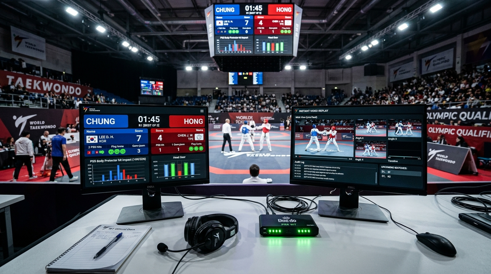
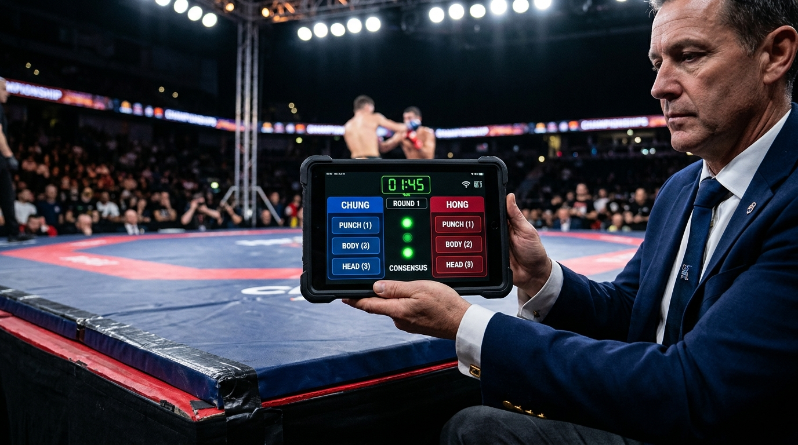
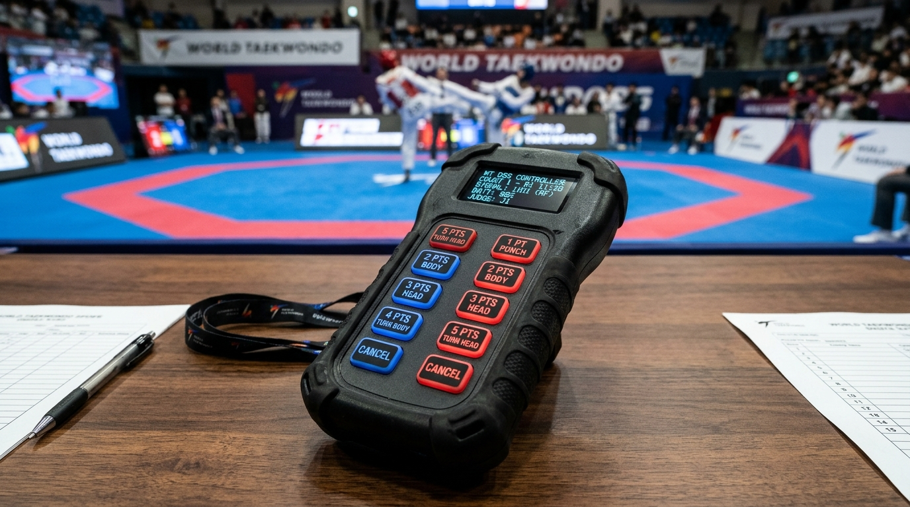
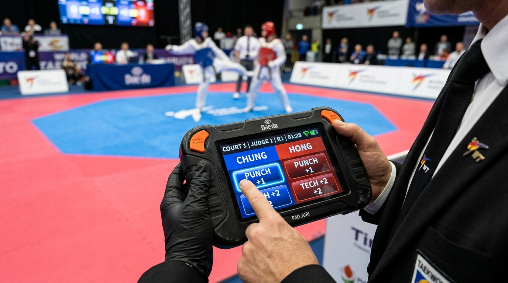

# Taekwondo Scoring Board Pro - Electronic Tournament System (World Taekwondo Standard)

Aplikasi template **Electronic Scoring Board (Papan Skor Digital)** untuk kejuaraan Taekwondo modern yang telah **100% disesuaikan dengan standar regulasi resmi World Taekwondo (WT)** dan mengadopsi sistem kompetisi **DAEDO TK-Strike Gen2 & KPNP PSS**.

Mendukung 3 kategori pertandingan utama:
1. 🥊 **Kyorugi (Sparring / Pertarungan)** - Regulasi *Best of 3 Rounds*, Point Gap, Gam-jeom limit (5 kotak), Instant Video Replay (IVR), Medical Timeout (60s), dan Buzzer otomatis.
2. 🏅 **Poomsae Recognised (Jurus Standar)** - Panel 5 Juri, sistem Akurasi (4.0) & Presentasi (6.0), kalkulasi otomatis *Truncated Mean* (mencoret nilai tertinggi & terendah).
3. ⚡ **Poomsae Freestyle (Jurus Bebas & Akrobatik)** - Timer musik 90-100s, 5 teknik wajib (*Compulsory kicks*), dan penalti durasi.

---

## 🎛️ 4 Mode Tampilan Perangkat (Tools Display)

Aplikasi ini dilengkapi 4 mode tampilan interaktif yang dapat dipilih langsung melalui navigasi atas:

| Mode Tampilan | Target Perangkat | Deskripsi & Fitur |
| :--- | :--- | :--- |
| **📺 1. Layar TV (Display)** | TV LED / Proyektor / OBS | Tampilan layar besar resolusi tinggi untuk atlet, pelatih, dan penonton. Menampilkan skor digital besar bercahaya (*glow*), timer pusat, ronde, Gam-jeom counter, banner Video Replay (IVR), dan Kesiapan Medis. |
| **🎛️ 2. Operator Meja** | Laptop Meja Pertandingan | Konsol kendali lengkap: tombol tambah poin cepat (+1, +2, +3, +4, +5, -1), Start/Pause timer (*Kye-sok / Kal-yeo*), tombol Gam-jeom (+/-), pemicu kartu banding Video Replay, dan Medical Timeout 60s. • **Aplikasi Monitoring Khusus:** Dashboard pengawas meja turnamen lengkap tersedia pada **[operator_monitoring_system.html](file:///c:/Users/susen/OneDrive/Documents/githublab/scooring%20board/operator_monitoring_system.html)**. |
| **📱 3. Pad Juri (Touch Pad)** | Tablet / Smartphone Juri | Antarmuka ramah sentuhan (*touch-friendly*) untuk hakim sudut dengan 2 pilihan mode: • **Model PSS (Sensor Elektronik KPNP / Daedo):** Tombol Pukulan (1 pt) & Teknik Putar (+2 pts). • **Model DSS (Digital Scoring System):** 6 Tombol Taktil manual lengkap (Pukulan 1pt, Badan 2pt, Kepala 3pt, Putar Badan 4pt, Putar Kepala 5pt, Batal/Koreksi -1pt) dengan indikator konsensus WT 1.0 detik. • **Poomsae:** Pengurangan akurasi (-0.1, -0.3) & slider presentasi. • **Aplikasi Khusus Tablet:** Tersedia antarmuka layar sentuh mandiri khusus tablet pada **[judge_pad_tablet.html](file:///c:/Users/susen/OneDrive/Documents/githublab/scooring%20board/judge_pad_tablet.html)**. |
| **📋 4. Jadwal Partai** | Laptop Panitia / Admin | Daftar bagan pertandingan (*match queue*). Operator cukup mengklik **"Muat Partai ↗"** untuk langsung memuat nama atlet, kontingen, dan kelas ke Layar TV. |

### 🖥️ Visual Display Monitoring Operator System Workstation (Meja Pertandingan)

Stasiun kerja pengawas meja pertandingan (*Table Operator & Match Supervisor Workstation*) standar resmi World Taekwondo (WT) dengan layar ganda monitoring telemetri sensor, konsensus juri, dan panel kendali jam master:

### 📱 Visual Display Judge Pad Khusus Tablet (Tablet Edition in Action)

Perangkat tablet 10.5 inci dalam genggaman wasit/juri sudut di sudut matras (*Do-yang*) dengan antarmuka ergonomis dua ibu jari (*dual-thumb touch interface*):

### Visual Perangkat Pad Juri Standar Model DSS (Digital Scoring System)

Perangkat kendali nirkabel manual DSS resmi World Taekwondo untuk kejuaraan non-sensor (Pra-Cadet, Pemula, Festival, & Kejurda):

### Visual Perangkat Pad Juri Standar KPNP & DAEDO (Model PSS Sensor)

### Tampilan Layar Penuh Pad Juri (3 Kategori Pertandingan)

#### 🎛️ Perbandingan Model PSS vs DSS pada Pad Juri Kyorugi
- **Model PSS (Protector & Scoring System):** Digunakan saat atlet menggunakan rompi/helm sensor elektronik Daedo TK-Strike Gen2 atau KPNP. Tendangan ke badan dan kepala dideteksi otomatis oleh sensor magnetik & impact switch. Juri sudut hanya menilai pukulan manual (*Punch* 1 pt) dan memvalidasi teknik putar (*Turning kick bonus* +2 pts).
- **Model DSS (Digital Scoring System):** Digunakan pada kejuaraan dengan pelindung badan konvensional (tanpa sensor PSS). Juri sudut memegang kendali penuh dengan 6 tombol taktil ergonomis untuk tiap sudut (Chung & Hong):
  1. 🥊 **Pukulan (Punch):** 1 Poin
  2. 🥋 **Tendangan Badan (Trunk Kick):** 2 Poin
  3. 🎯 **Tendangan Kepala (Head Kick):** 3 Poin
  4. 🌪️ **Tendangan Putar Badan (Turning Trunk Kick):** 4 Poin (2 + 2)
  5. ⚡ **Tendangan Putar Kepala (Turning Head Kick):** 5 Poin (3 + 2)
  6. ↩️ **Batal / Koreksi:** -1 Poin
- **Aturan Konsensus WT (Tolerance Window):** Pada sistem 3 juri, poin DSS dinyatakan sah jika minimal **2 dari 3 juri** menekan tombol teknik yang sama dalam rentang jendela waktu toleransi **1.0 detik** (indikator lampu konsensus hijau J1-J2-J3 menyala serentak).

---

## 📺 Tampilan Layar TV & Fitur Canggih

- **Dual Screen Real-Time Sync (0ms Latensi):** Mendukung setup 2 layar (Laptop Operator di meja + TV LED / Proyektor untuk penonton). Perubahan skor di laptop operator langsung muncul di TV secara instan via `BroadcastChannel` dan `localStorage` fallback.
- **Audio Synthesizer Terintegrasi (100% Offline):** Suara klakson buzzer resmi, tanda jeda *Kalyeo*, dan aba-aba wasit langsung disintesis melalui Web Audio API tanpa membutuhkan file MP3 eksternal atau koneksi internet.
- **Dukungan Layar Penuh (Fullscreen):** Cukup tekan **F11** atau tombol *Fullscreen* di navigasi.

---

## 🚀 Cara Menjalankan

### Pilihan 1: Versi Mandiri All-in-One (Satu File Lengkap — 100% Offline)
Buka file **`taekwondo_scoring_board_all_in_one.html`** langsung dengan klik ganda di browser apa pun. Semua kode CSS, JavaScript logika, suara buzzer Web Audio, dan tampilan sudah terbundel utuh dalam 1 file tunggal (sangat cocok dipindahkan via flashdisk ke laptop pertandingan tanpa risiko file terpisah hilang).

### Pilihan 2: Versi Modular (`index.html`)
Buka file **`index.html`** yang terhubung secara modular dengan sub-folder `css/custom.css` dan modul `js/` (sangat cocok untuk pengembangan kode lebih lanjut).

### Menjalankan di Dua Layar (Laptop Operator + Layar TV Lapangan)
1. Sambungkan laptop ke TV LED atau Proyektor via kabel HDMI.
2. Atur display mode Windows ke **Extend** (`Windows Key + P` -> pilih **Extend**).
3. Buka browser:
   - **Layar 1 (Laptop Operator):** Buka `taekwondo_scoring_board_all_in_one.html?mode=operator` (atau `index.html?mode=operator`).
   - **Layar 2 (TV Lapangan):** Buka jendela baru di layar TV: `taekwondo_scoring_board_all_in_one.html?mode=tv`, lalu tekan **F11** untuk layar penuh.
4. Semua klik tombol skor, timer, dan ronde di laptop operator akan langsung menggerakkan layar TV secara instan via `BroadcastChannel` (0ms latensi tanpa internet)!

---

## 🖨️ Cetak Berita Acara Pertandingan Resmi Standar WT
- Klik tombol **🖨️ Cetak** pada bilah navigasi atau tombol **🖨️ Cetak Berita Acara** setelah pertandingan usai. Sistem secara otomatis menyusun dan mencetak lembar Berita Acara Resmi (*Official Match Protocol & Scoresheet*) standar World Taekwondo (WT-FR-01, WT-FR-02, WT-FR-03) lengkap dengan rincian poin per-ronde, log kartu IVR coach, catatan penalti, serta blok 4 tanda tangan dewan wasit dan Technical Delegate.
- Template cetak mandiri A4 juga dapat dibuka dan dicetak langsung pada berkas: **[form_berita_acara_wt.html](file:///c:/Users/susen/OneDrive/Documents/githublab/scooring%20board/form_berita_acara_wt.html)** dan spesifikasi dokumentasi pada **[FORM_BERITA_ACARA_STANDAR_WT.md](file:///c:/Users/susen/OneDrive/Documents/githublab/scooring%20board/FORM_BERITA_ACARA_STANDAR_WT.md)**.

---

## ⌨️ Shortcut Keyboard untuk Operator
- **[Spasi]**: Mulai / Jeda Timer (*Kye-sok / Kal-yeo*)
- **[B]**: Bunyikan Klakson Buzzer
- **[1]**: Pindah ke Kategori Kyorugi
- **[2]**: Pindah ke Kategori Poomsae Recognised
- **[3]**: Pindah ke Kategori Poomsae Freestyle
- **[F11]**: Tampilan Layar Penuh (Fullscreen TV)
