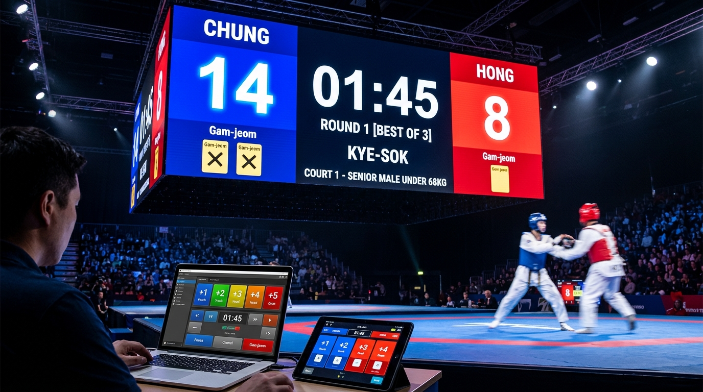
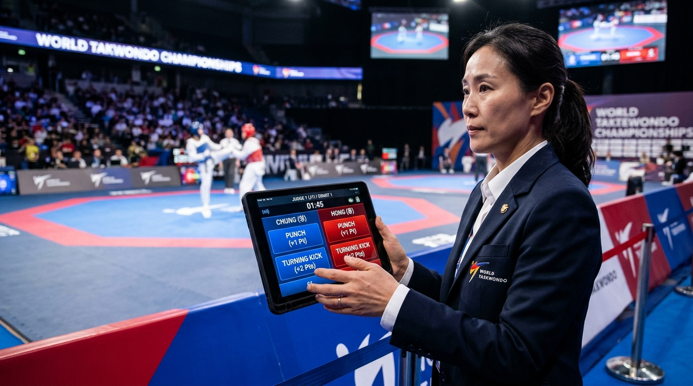
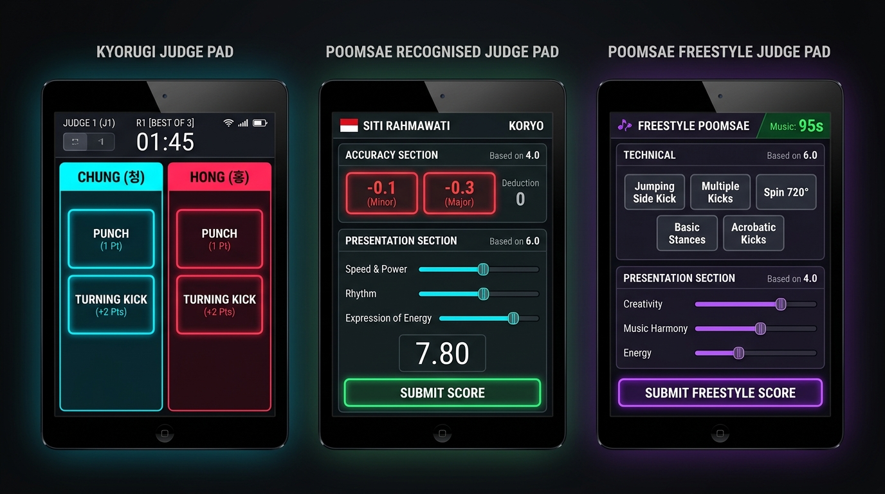

# Taekwondo Scoring Board Pro - Electronic Tournament System

Aplikasi template **Electronic Scoring Board (Papan Skor Digital)** untuk kejuaraan Taekwondo modern sesuai standar resmi **World Taekwondo (WT)**.

Mendukung 3 kategori pertandingan utama:
1. 🥊 **Kyorugi (Sparring / Pertarungan)** - Regulasi *Best of 3 Rounds*, Point Gap, Gam-jeom limit (5 kotak), Instant Video Replay (IVR), Medical Timeout (60s), dan Buzzer otomatis.
2. 🏅 **Poomsae Recognised (Jurus Standar)** - Panel 5 Juri, sistem Akurasi (4.0) & Presentasi (6.0), kalkulasi otomatis *Truncated Mean* (mencoret nilai tertinggi & terendah).
3. ⚡ **Poomsae Freestyle (Jurus Bebas & Akrobatik)** - Timer musik 90-100s, 5 teknik wajib (*Compulsory kicks*), dan penalti durasi.

---

## 🎛️ 4 Mode Tampilan Perangkat (Tools Display)

Aplikasi ini dilengkapi 4 mode tampilan interaktif yang dapat dipilih langsung melalui navigasi atas:

| Mode Tampilan | Target Perangkat | Deskripsi & Fitur |
| :--- | :--- | :--- |
| **📺 1. Layar TV (Display)** | TV LED / Proyektor / OBS | Tampilan layar besar resolusi tinggi untuk atlet, pelatih, dan penonton. Menampilkan skor digital besar bercahaya (*glow*), timer pusat, ronde, Gam-jeom counter, banner Video Replay (IVR), dan Kesiapan Medis. |
| **🎛️ 2. Operator Meja** | Laptop Meja Pertandingan | Konsol kendali lengkap: tombol tambah poin cepat (+1, +2, +3, +4, +5, -1), Start/Pause timer (*Kye-sok / Kal-yeo*), tombol Gam-jeom (+/-), pemicu kartu banding Video Replay, dan Medical Timeout 60s. |
| **📱 3. Pad Juri (Touch Pad)** | Tablet / Smartphone Juri | Antarmuka ramah sentuhan (*touch-friendly*) untuk hakim sudut. Pada Kyorugi terdapat tombol sentuh besar Pukulan Biru/Merah (1 poin). Pada Poomsae terdapat tombol pengurangan cepat Akurasi (-0.1, -0.3) dan slider Presentasi. |
| **📋 4. Jadwal Partai** | Laptop Panitia / Admin | Daftar bagan pertandingan (*match queue*). Operator cukup mengklik **"Muat Partai ↗"** untuk langsung memuat nama atlet, kontingen, dan kelas ke Layar TV. |

### Visual Perangkat Pad Juri (Corner Judge Tablet)

### Tampilan Layar Penuh Pad Juri (3 Kategori Pertandingan)

---

## 📺 Tampilan Layar TV & Fitur Canggih

- **Dual Screen Real-Time Sync (0ms Latensi):** Mendukung setup 2 layar (Laptop Operator di meja + TV LED / Proyektor untuk penonton). Perubahan skor di laptop operator langsung muncul di TV secara instan via `BroadcastChannel` dan `localStorage` fallback.
- **Audio Synthesizer Terintegrasi (100% Offline):** Suara klakson buzzer resmi, tanda jeda *Kalyeo*, dan aba-aba wasit langsung disintesis melalui Web Audio API tanpa membutuhkan file MP3 eksternal atau koneksi internet.
- **Dukungan Layar Penuh (Fullscreen):** Cukup tekan **F11** atau tombol *Fullscreen* di navigasi.

---

## 🚀 Cara Menjalankan

### Cara 1: Buka Langsung (Tanpa Install Apapun)
Cukup klik ganda (double-click) file `index.html` di browser Anda (Google Chrome, Microsoft Edge, atau Mozilla Firefox).

### Cara 2: Menjalankan di Dua Layar (Laptop Operator + Layar TV Lapangan)
1. Sambungkan laptop ke TV LED atau Proyektor via kabel HDMI.
2. Atur display mode Windows ke **Extend** (`Windows Key + P` -> pilih **Extend**).
3. Buka browser:
   - **Layar 1 (Laptop Operator):** Buka `index.html` dan pilih mode **🎛️ Operator Meja**.
   - **Layar 2 (TV Lapangan):** Buka jendela baru di layar TV: `index.html?mode=tv`, lalu tekan **F11** untuk layar penuh.
4. Semua klik tombol skor, timer, dan ronde di laptop operator akan langsung menggerakkan layar TV secara instan!

---

## ⌨️ Shortcut Keyboard untuk Operator
- **[Spasi]**: Mulai / Jeda Timer (*Kye-sok / Kal-yeo*)
- **[B]**: Bunyikan Klakson Buzzer
- **[1]**: Pindah ke Kategori Kyorugi
- **[2]**: Pindah ke Kategori Poomsae Recognised
- **[3]**: Pindah ke Kategori Poomsae Freestyle
- **[F11]**: Tampilan Layar Penuh (Fullscreen TV)
